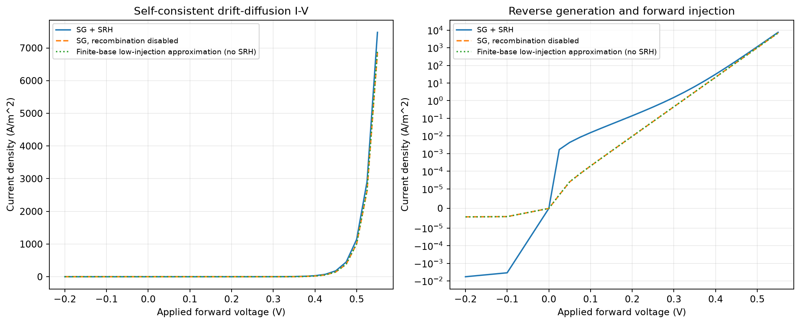
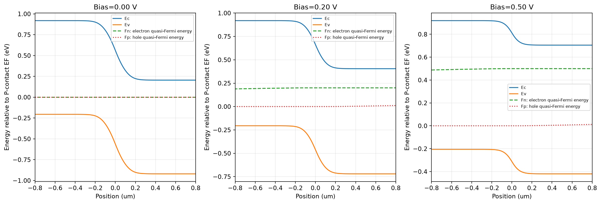
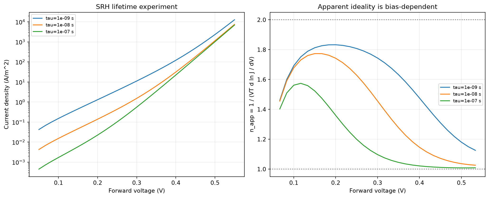
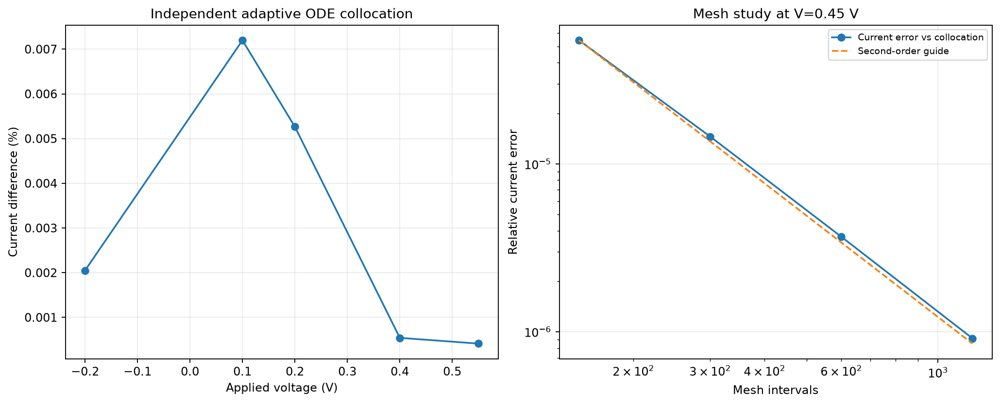
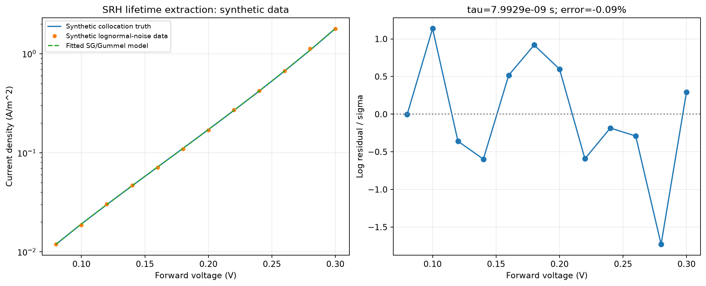

# mini-tcad-drift-diffusion

一维硅 PN 结漂移-扩散仿真：从器件方程直接计算电流，研究复合寿命、表观理想因子与数值可信度。PN Junction（P-type-N-type Junction，P 型与 N 型半导体形成的结）是研究对象。

这是 `mini-tcad-pn` 和 `mini-tcad-moscap` 之后的第三阶段教学型 TCAD（Technology Computer-Aided Design，工艺与器件计算机辅助设计）项目。Drift-Diffusion（漂移-扩散）模型同时描述电场驱动的漂移和浓度梯度驱动的扩散；本项目联立电势、电子与空穴输运，得到正向/反向 I-V（Current-Voltage，电流-电压）特性。



## 一键运行

需要 Python 3.10 或更新版本：

```bash
git clone https://github.com/carveself/mini-tcad-drift-diffusion.git
cd mini-tcad-drift-diffusion
python -m venv .venv
```

激活环境，按系统选择：

```bash
# macOS / Linux
source .venv/bin/activate
# Windows PowerShell
# .venv\Scripts\Activate.ps1
```

```bash
python -m pip install -r requirements.txt
python run_all.py
python -m unittest discover -s tests -v
```

自动保存 8 张主结果图、CSV 和 JSON，不需要弹出绘图窗口。主网格默认为 601 个节点，合成反演使用 301 点。主计算、独立对照及寿命提取均已实际运行；13 项测试通过。

```bash
python run_all.py --nodes 1201 --fit-nodes 601 --output reproduction/fine
python src/stages.py equilibrium --output reproduction/01-equilibrium
python src/stages.py biased --output reproduction/02-biased
```

默认输出相对于项目根目录；指定相对路径相对于运行命令的目录。重复运行覆盖同名输出。图表中的 $`J`$ 是电流密度，单位 A/m²；实际电流为 $`I=A_{device}J`$。例如 100 μm × 100 μm 的面积为 $`10^{-8}`$ m²，不能把电流密度直接标成 A。

## 关键新增内容

| 概念 | 英文全称、中文含义及用途 |
| --- | --- |
| Poisson equation | 泊松方程；用空间电荷决定静电势，与载流子输运自洽耦合 |
| Continuity equation | 连续性方程；表达电子与空穴的守恒，约束电流随空间的变化 |
| SG | Scharfetter-Gummel discretization，沙尔费特-古梅尔离散；在边上积分漂移-扩散关系，稳定计算电流 |
| Gummel iteration | 古梅尔迭代；交替求解非线性泊松和两种载流子方程，直到三者一致 |
| SRH | Shockley-Read-Hall recombination，肖克利-里德-霍尔复合；模拟陷阱辅助复合与反向产生 |
| Quasi-Fermi level | 准费米能级；在非平衡下分别描述电子和空穴的电化学状态 |
| Collocation method | 配点法；用另一套连续方程离散检查 SG 求解结果 |
| Apparent ideality factor | 表观理想因子；由 I-V 的局部对数斜率分析主导输运机制 |

数值电流来自 SG/连续性方程；图中的理想有限基区公式只作为单独的解析近似对照。主模型保留两种移动载流子和非零偏压下的准费米能级分离。



## 完成的实验

1. 平衡、反向产生与正向注入：25 个 I-V 点，比较 SRH 开启与关闭。
2. 电势、载流子、准费米能级、能带与空间复合率；正向电子与空穴电流相互转换。
3. 三个寿命各扫描 31 个正向偏压；理想因子省略数值微分端点，保留 87 个内点。
4. 五个偏压下与自适应连续方程配点法对照；151/301/601/1201 点的网格收敛。
5. Gummel 混合比例、偏压路径、局部浮点相消与通量积分求值的数值实验。
6. 用独立配点法生成带噪声合成数据，再由 SG/Gummel 模型提取一个共同的 SRH 寿命。



研究问题是：改变寿命为什么会改变正向电流和局部理想因子？复合、扩散、有限基区与有限偏压项如何共同决定曲线？图中理想因子是计算结果，不预设成固定的 1 或 2。

## 验证结果与精确含义

基准器件：P/N 侧受主/施主浓度均为 $`10^{16}`$ cm⁻³，从结中心到两端接触各 2 μm，掺杂以 20 nm 尺度平滑过渡，300 K，SRH 共同寿命 10 ns。

| 指标 | 基准结果，约值 |
| --- | ---: |
| 内建势 | 0.714317 V |
| 0.2 V 电流密度 | 0.139062 A/m² |
| 五个对照偏压最大相对电流差异 | 0.00720% |
| 对照的最大电势差异 | 7.71 μV |
| 最大归一化泊松残差 | $`1.79\times10^{-10}`$ |
| 最大通量重建对数活动度误差 | $`9.14\times10^{-10}`$ |
| 自动测试 | 13 项通过 |

配点法对照的偏压为 -0.2、0.1、0.2、0.4、0.55 V。它使用 SG 结果作为初值，再独立求解六个连续一阶微分方程并自适应加密；没有复用 SG 空间离散。这里的“独立”指方程实现与离散方法不同，不指材料模型、参数或初值来源都不相同。配点残差也不等于真实解误差的严格上界。



稳态总电流守恒是离散结构的结果，不能单独当作正确性证明。代码同时检查从电流反积分重建活动度是否匹配求解剖面，并与配点法、网格、低注入解析近似和偏压路径相互核对。详见 [数值模型](docs/MODEL.md)。

## 一个值得复现的数值问题

在中性区，直接用两个很接近的大数计算局部 SG 电流，低电流下可能放大浮点误差。代码保留 `Jn_raw`、`Jp_raw` 作为诊断，主要电流则通过同一个 SG 系统的积分连续性与两端活动度约束求得。

这种求值没有使用理想二极管公式，也没有随意把局部电流拉平。电子/空穴电流与复合源项的关系、接触活动度总降落和重建误差均可核查。[模型文档](docs/MODEL.md)给出推导，`current_continuity.png` 展示两种求值的差别。

## 合成寿命提取

真实共同寿命设为 8 ns，在 0.08-0.30 V 的 12 个点用配点法生成正向电流，再加上对数标准差 0.02 的噪声，固定随机种子 20261019。逆模型使用 301 点 SG 网格。

| 参数 | 合成真实值 | 提取值 | 相对误差 |
| --- | ---: | ---: | ---: |
| 共同 SRH 寿命 | 8.000 ns | 7.99294 ns | -0.0883% |



这是合成验证，未使用实验室数据。掺杂、几何、温度、迁移率、接触与本征浓度在提取中视为已知，只拟合一个共同寿命；不能据此声称已经唯一提取陷阱能级、俘获截面或真实器件寿命。局部约 0.49% 的相对一倍标准差也依赖这些已知参数与模型假设。

## 学习与复试准备材料

- [分阶段复现](docs/REPRODUCE.md)：从平衡、SG 通量到复合、独立验证和反演。
- [方程与数值细节](docs/MODEL.md)：单位、接触、准费米能级符号、SG 和稳健电流求值。
- [口述与追问](docs/INTERVIEW.md)：按清华集成电路学院 2026 公开细则准备练习，含英文简介。
- [五页报告](docs/REPORT.pdf) / [文字版](docs/REPORT.md)：问题、方法、验证、结果与局限。
- [验证记录](docs/VALIDATION.md)：环境、命令和数据路径。

清华集成电路学院 2026 统招公开细则考查专业知识、实践和分析能力，个人自述约 3 分钟且不使用 PPT；这里据此设计口头表达练习。具体院系、年份与招生类型应以对应通知为准。本仓库不声称获得学校认可或保证录取加分。[官方细则](https://yzbm.tsinghua.edu.cn/publish/s02/s0201/detail/e0a99c31-8a56-4ec5-a9c5-f98524c06fff?yxsdm=026)

## 模型范围

一维经典硅同质结，平滑掺杂、完全电离、玻尔兹曼统计、固定迁移率与中间禁带 SRH 陷阱；两端是理想欧姆接触。没有速度饱和、雪崩、隧穿、量子修正、自热或接触电阻。当前自动实验只覆盖所列基准、偏压与参数；小离散误差不等于对真实器件同样精确。

代码将试验偏压限制在 -0.3 到 0.65 V，主实验到 0.55 V。改变温度、几何或掺杂后需要重新做收敛与模型适用性检查。能带的本征能级采用中禁带近似。

默认结果已在 Python 3.12、NumPy 2.3.5、SciPy 1.18.1、Matplotlib 3.11.2 上验证。

重建报告可选安装 `requirements-report.txt` 后运行 `python src/build_report.py`。报告是默认基准的静态文字，改变参数后需同步更新再重建。

## 参考资料

- [TU Wien：SG 漂移-扩散离散](https://www.iue.tuwien.ac.at/pdf/ib_2010/BC2010_Triebl_1.pdf)。
- [TU Wien：非线性系统与 Gummel 方法](https://iue.tuwien.ac.at/phd/wimmer/node70.html)。
- [TU Wien：SRH 产生与复合](https://www.iue.tuwien.ac.at/phd/quay/node41.html)。
- [SciPy：自适应配点边值求解器](https://docs.scipy.org/doc/scipy/reference/generated/scipy.integrate.solve_bvp.html)。

参考实现已完成。复现时保留基准，在自己的分支中重写和验证，并用自己的失败记录与扩展实验说明实际贡献。
