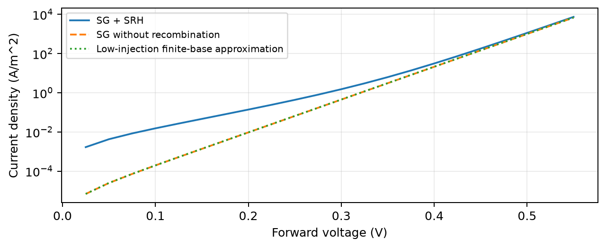
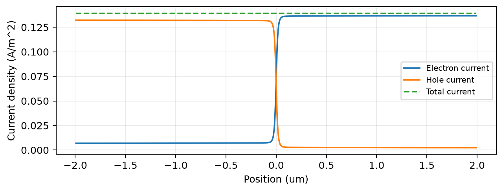
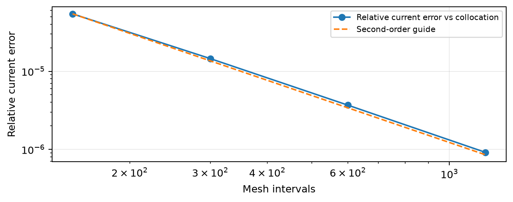
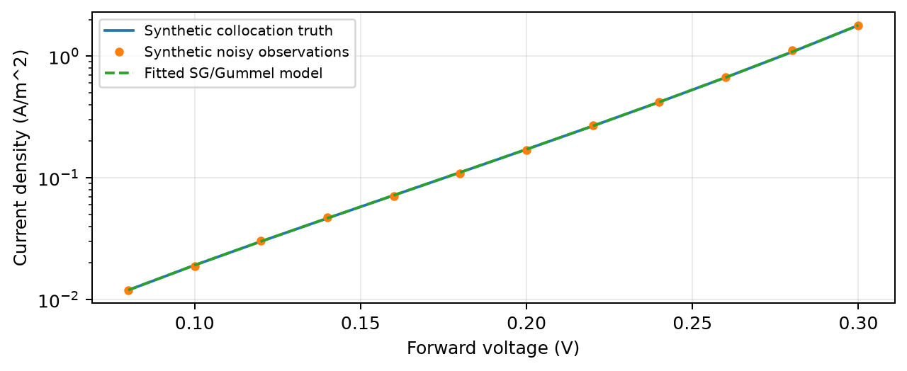

# PN 结漂移-扩散与复合寿命研究

技术报告 | 基准 v1 | 2026-10-19

## 1. 从静电学走向非平衡输运

本项目研究一维硅 PN 结的电流、复合与表观理想因子。与预设电荷的静电分析相比，这里同时求解泊松方程和电子、空穴连续性方程，电流由漂移-扩散关系得到。两个准费米能级的分离描述非平衡状态。

| 基准参数 | 数值 |
| --- | --- |
| 两侧掺杂 | NA=ND=1e16 cm^-3 |
| 结中心到 P/N 接触距离 | 各 2 um，总长 4 um |
| 平滑掺杂过渡尺度 / 温度 | 20 nm / 300 K |
| 共同中禁带 SRH 寿命 | 10 ns |
| 主网格 / 主 I-V 点数 | 601 点 / 25 点 |

短寿命增强结内复合电流，反向则出现净产生。关闭复合后，低注入电流接近有限中性基区解析近似。主结果使用电流密度 A/m^2，换成电流必须再乘器件面积。

交付包含 8 张主图、独立配点验证、四级网格研究、合成寿命反演、13 项测试与中文复现材料。它是经典教学模型，不是经过真实器件标定的工艺模型。

<!-- page -->

# 2. 方程、SG 离散与 Gummel 迭代

电荷进入 -eps*psi''=q*(p-n+C)。电子和空穴电流同时包含电场漂移与浓度扩散，连续性方程为 dJn/dx=qR、dJp/dx=-qR。SRH 是 Shockley-Read-Hall，即陷阱辅助复合；共同寿命 tau 与中禁带陷阱给出 R=(np-ni^2)/(tau*(n+p+2ni))。

采用 u=psi/VT、n=ni*exp(u+a)、p=ni*exp(-u+b)。Fn=VT*a，Fp=-VT*b，以 eV 表示；接触符号通过载流子关系检验。用稳定的伯努利函数构建 Scharfetter-Gummel 边通量，再以 Gummel 方法交替解泊松和两种连续性子问题。

泊松子步使用解析三对角雅可比与阻尼牛顿法；活动度更新使用正系数线性系统和对数混合，偏压内部续接步长不超过 0.025 V。

低电流中性区直接相减大活动度可能产生浮点噪声。程序保留原始边电流，同时用同一个 SG 系统的积分连续性与两端活动度约束稳健求值。再把电流反积分，检查重建活动度是否与节点解一致。

总电流恒定是离散结构性质，不单独作为正确性证据。这个数值问题与符号、单位、边界一起构成复现时值得解释的重点。

<!-- page -->

# 3. 独立对照、网格与误差分析

参考支路使用六个连续一阶方程与自适应配点法。SG 剖面只提供初值，参考算法重新求解并加密；方程实现和空间离散不同，物理模型相同。因此它提供交叉检查，但不等价于实验验证。

| 指标 | 基准结果，约值 |
| --- | --- |
| 五个对照偏压的最大相对电流差异 | 0.00720% |
| 最大电势差异 | 7.71e-6 V |
| 最大归一化泊松残差 | 1.79e-10 |
| 最大通量重建对数活动度误差 | 9.14e-10 |
| 0.20 V 电流密度 | 0.139062 A/m^2 |

151、301、601、1201 点逐步加密时，误差接近二阶下降。13 项测试还覆盖平衡零通量、伯努利恒等式、接触中性、准费米符号、复合源项、非正浓度保护、解析极限、路径与混合比例，以及非对称结。

一次有用的数值失败是参考支路使用对数浓度时出现接触处很薄的对数层。改用 ni 归一化的直接浓度后，配点法能稳定处理这一边值问题。变量选择要结合方程形式，不能只套用一种经验。

<!-- page -->

# 4. 寿命、理想因子与合成反演

对 1、10、100 ns 三个寿命各求解 31 个偏压，局部理想因子由 1/(VT*d ln J/dV) 得到，省略端点。它由复合、扩散及有限偏压等共同决定，未预设成 1 或 2。该实验用于连接曲线斜率与器件内部机制。

寿命反演由独立配点法在 0.08-0.30 V 生成 12 个正向电流，加上标准差 0.02 的对数噪声，随机种子固定为 20261019。逆模型使用 301 点 SG/Gummel 网格，只拟合一个共同寿命。

| 量 | 合成真实值 / 提取结果 |
| --- | --- |
| 共同 SRH 寿命 | 8.000 ns / 7.99294 ns |
| 单个种子的相对误差 | -0.0883% |
| 局部相对一倍标准差 | 约 0.49%，有条件的线性化估计 |

数据明确标为合成，不是测量值。掺杂、几何、温度、迁移率、本征浓度和理想接触视为已知。该实验不能证明真实器件寿命精度，也不能独立确定陷阱密度、能级与俘获截面。

建议继续改变噪声、偏压覆盖范围或已知迁移率，区分随机不确定度、模型失配与多参数可辨识性问题。

<!-- page -->

# 5. 局限、复现与技术表达

## 模型边界

当前模型是一维、经典、完全电离的硅同质结，采用玻尔兹曼统计、固定迁移率、共同中禁带 SRH 寿命和理想欧姆接触。没有速度饱和、量子效应、接触电阻、自热、雪崩或隧穿。高场下固定迁移率尤其需要重新评估。

自动实验只验证所列基准与偏压。小残差、小网格差异和两套数值方法一致说明该数学模型被可靠求解，不自动保证真实器件预测准确。

## 复现顺序

先运行 run_all.py 和 13 项测试建立基准；再按 REPRODUCE.md 重写平衡、SG 边通量、偏压接触、SRH、稳健电流与配点参考，最后做寿命反演。每一步保留单位检查、失败记录和独立证据。

个人扩展可以选择接触距离、过渡宽度、数据偏压范围或迁移率设错的影响。一次只改变清楚的变量，先预测，再实验，再解释误差。

## 复试表达材料

INTERVIEW.md 提供项目技术口述、英文简介和追问方向，参照清华集成电路学院公开材料准备练习；实际要求以报考院系当年通知为准。项目不保证录取加分，也不替代专业基础学习。

陈述时明确参考实现与自己实际复现、重写、排错和扩展的部分。能解释为何选择 SG、为什么守恒还不够、以及一项真实失败与修复，比堆砌项目名称更能展示理解。

## 来源与追溯

仓库：https://github.com/carveself/mini-tcad-drift-diffusion

物理与数值背景：TU Wien 的 SG 漂移-扩散、Gummel 与 SRH 资料；SciPy solve_bvp 官方文档。完整链接和官方复试资料链接见主 README。

基准环境：Python 3.12 / NumPy 2.3.5 / SciPy 1.18.1 / Matplotlib 3.11.2。精确结果以 figures/validation.json、independent_reference.csv 和 extraction.json 为准。本报告为默认基准静态文字，修改模型后需更新文字并重建。
